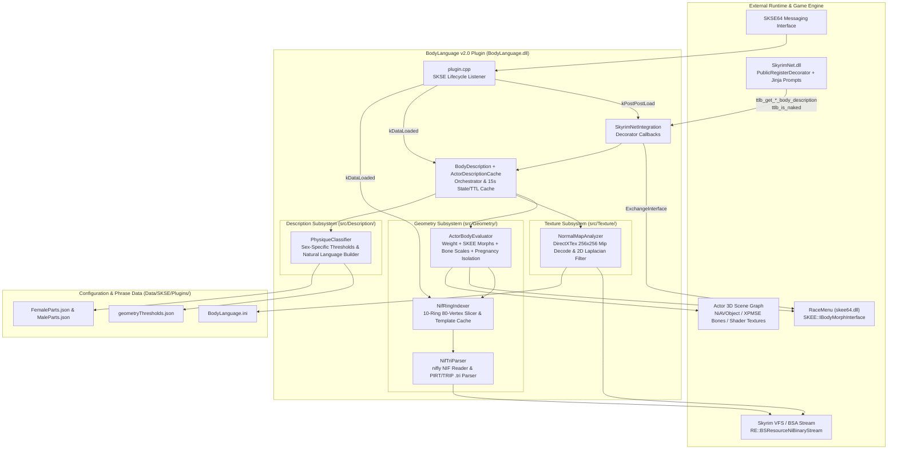
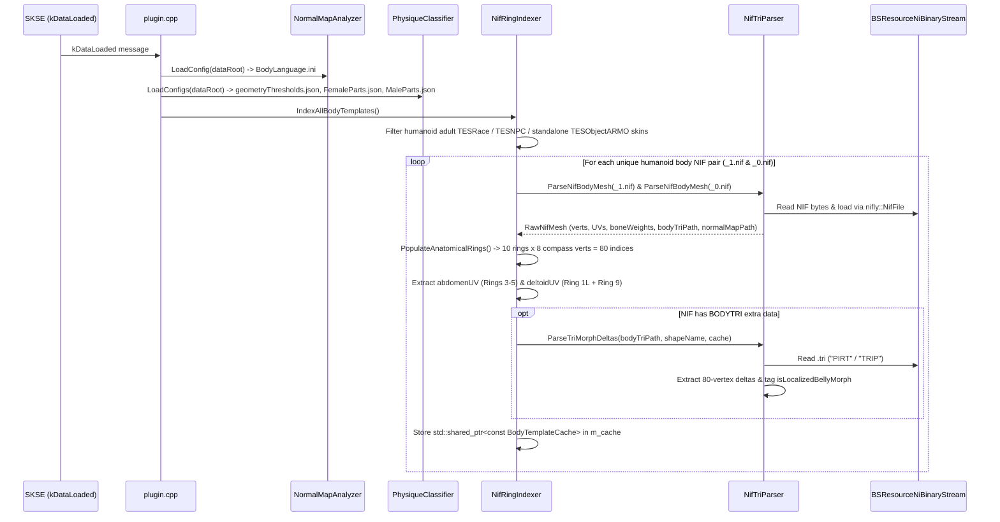
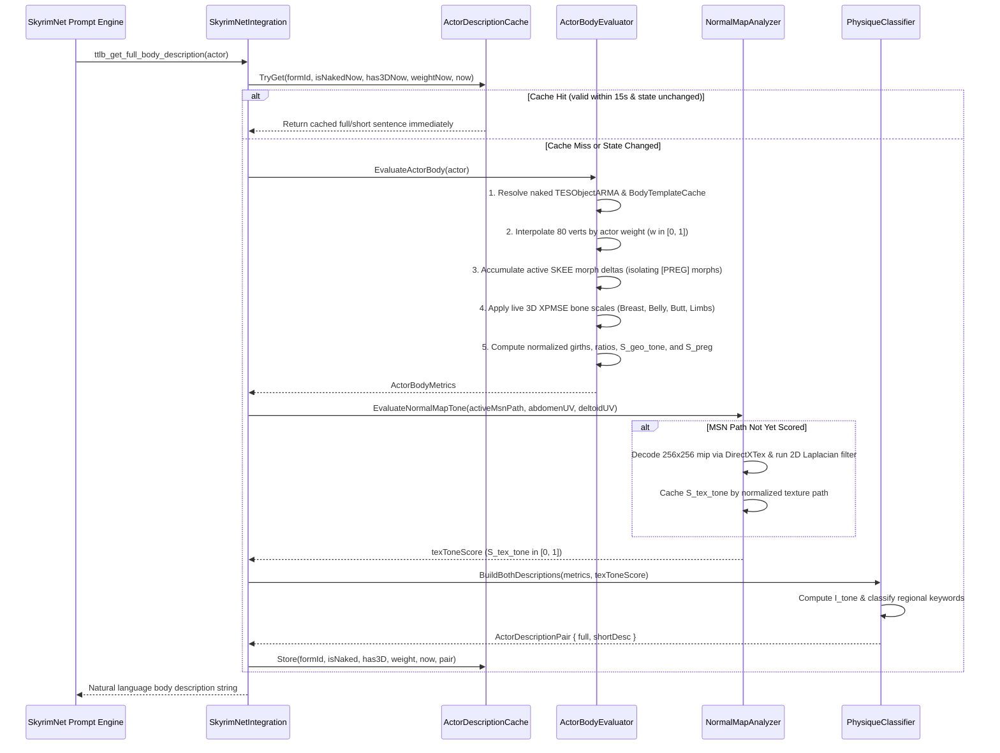

# BodyLanguage v2.0 — Architecture & Lifecycle Documentation

## 1. Overview

**BodyLanguage v2.0** is a real-time, mod-agnostic 3D geometry and normal-map analysis engine for **SkyrimNet**. Instead of relying on static BodySlide preset databases or pre-hashed texture archives, it inspects each NPC's actual 3D body topology, active RaceMenu (`skee64`) morph sliders, live XPMSE skeleton bone scales, and object-space normal maps (`_msn.dds`) directly through Skyrim's Virtual File System (`RE::BSResourceNiBinaryStream`).

---

## 2. High-Level Component Architecture

### Module Responsibilities

| Module | Files | Responsibility |
| :--- | :--- | :--- |
| **Plugin Entry & Lifecycle** | [`plugin.cpp`](file:///e:/Skyrim/development/mods/BodyLanguage%20Dev/SKSE_Source/plugin.cpp) | Initializes `spdlog`, resolves the `Data/` directory, and dispatches SKSE lifecycle events (`kPostPostLoad`, `kDataLoaded`, `kPreLoadGame`, `kPostLoadGame`, `kNewGame`). |
| **SkyrimNet Bridge** | [`SkyrimNetIntegration.h`](file:///e:/Skyrim/development/mods/BodyLanguage%20Dev/SKSE_Source/src/SkyrimNetIntegration.h), [`SkyrimNetIntegration.cpp`](file:///e:/Skyrim/development/mods/BodyLanguage%20Dev/SKSE_Source/src/SkyrimNetIntegration.cpp) | Locates `PublicRegisterDecorator` in `SkyrimNet.dll`, initializes `SKEE::IBodyMorphInterface`, and exposes `ttlb_get_full_body_description`, `ttlb_get_short_body_description`, `ttlb_is_naked`, and `ttlb_get_genitals`. |
| **Orchestrator & Per-Actor Cache** | [`BodyDescription.h`](file:///e:/Skyrim/development/mods/BodyLanguage%20Dev/SKSE_Source/src/BodyDescription.h), [`BodyDescription.cpp`](file:///e:/Skyrim/development/mods/BodyLanguage%20Dev/SKSE_Source/src/BodyDescription.cpp) | Coordinates `ActorBodyEvaluator`, `NormalMapAnalyzer`, and `PhysiqueClassifier`. Maintains `ActorDescriptionCache` (keyed by `RE::FormID`) storing `"full"`, `"short"`, and `"genitalsJson"` with automatic state & TTL invalidation. |
| **NIF & TRI Parser** | [`NifTriParser.h`](file:///e:/Skyrim/development/mods/BodyLanguage%20Dev/SKSE_Source/src/Geometry/NifTriParser.h), [`NifTriParser.cpp`](file:///e:/Skyrim/development/mods/BodyLanguage%20Dev/SKSE_Source/src/Geometry/NifTriParser.cpp) | Streams `.nif` and `.tri` files via `RE::BSResourceNiBinaryStream`. Uses `nifly` to extract vertices, UVs, skin bone weights, `BODYTRI` extra data, and shader texture paths. Parses `"PIRT"`/`"TRIP"` morph deltas for the 80 landmark vertices and tags localized belly/pregnancy morphs (`isLocalizedBellyMorph`). |
| **10-Ring Landmark Indexer** | [`BodyTemplateCache.h`](file:///e:/Skyrim/development/mods/BodyLanguage%20Dev/SKSE_Source/src/Geometry/BodyTemplateCache.h), [`NifRingIndexer.h`](file:///e:/Skyrim/development/mods/BodyLanguage%20Dev/SKSE_Source/src/Geometry/NifRingIndexer.h), [`NifRingIndexer.cpp`](file:///e:/Skyrim/development/mods/BodyLanguage%20Dev/SKSE_Source/src/Geometry/NifRingIndexer.cpp) | Slices `_1.nif` and `_0.nif` into **10 anatomical cross-section rings × 8 compass directions = 80 vertices**, extracts `abdomenUV` and `deltoidUV` bounding boxes, and caches `BodyTemplateCache` instances. |
| **Runtime 3D Body Evaluator** | [`ActorBodyEvaluator.h`](file:///e:/Skyrim/development/mods/BodyLanguage%20Dev/SKSE_Source/src/Geometry/ActorBodyEvaluator.h), [`ActorBodyEvaluator.cpp`](file:///e:/Skyrim/development/mods/BodyLanguage%20Dev/SKSE_Source/src/Geometry/ActorBodyEvaluator.cpp) | Reconstructs an actor's 80 naked body vertices at runtime (weight interpolation + SKEE morph deltas + XPMSE bone scales), computes normalized girths/ratios, isolates localized belly distension (`pregnancyBellyScore`), and evaluates exposed TNG/SOS genital addons & bone scales (`EvaluateActorGenitals`). |
| **Normal Map Analyzer** | [`NormalMapAnalyzer.h`](file:///e:/Skyrim/development/mods/BodyLanguage%20Dev/SKSE_Source/src/Texture/NormalMapAnalyzer.h), [`NormalMapAnalyzer.cpp`](file:///e:/Skyrim/development/mods/BodyLanguage%20Dev/SKSE_Source/src/Texture/NormalMapAnalyzer.cpp) | Streams `_msn.dds` via `RE::BSResourceNiBinaryStream`, decodes the $256 \times 256$ mipmap level via `DirectXTex`, runs a 2D high-pass Laplacian filter over `abdomenUV` and `deltoidUV` to measure muscle groove sharpness ($S_{\text{tex\_tone}} \in [0, 1]$), and caches the score per texture path. |
| **Physique Classifier** | [`PhysiqueClassifier.h`](file:///e:/Skyrim/development/mods/BodyLanguage%20Dev/SKSE_Source/src/Description/PhysiqueClassifier.h), [`PhysiqueClassifier.cpp`](file:///e:/Skyrim/development/mods/BodyLanguage%20Dev/SKSE_Source/src/Description/PhysiqueClassifier.cpp) | Combines geometric and texture tone signals into $I_{\text{tone}} \in [-1, +1]$, applies sex-specific thresholds from `geometryThresholds.json`, builds clothed/naked `"full"` and `"short"` prose from `FemaleParts.json` / `MaleParts.json`, and builds the TNG/SOS genital JSON payload (`BuildGenitalsJson`). |

---

## 3. Full Lifecycle & Event Flows

### Phase 1: DLL Load (`SKSEPluginLoad`)
1. **SKSE Initialization:** `SKSE::Init(skse)` initializes CommonLibSSE-NG trampolines and interfaces.
2. **Logging Setup:** Creates `Documents/My Games/Skyrim Special Edition/SKSE/BodyLanguage.log` with immediate flush on `info` level.
3. **Listener Registration:** Registers the main SKSE messaging callback in [`plugin.cpp`](file:///e:/Skyrim/development/mods/BodyLanguage%20Dev/SKSE_Source/plugin.cpp).

---

### Phase 2: All SKSE Plugins Loaded (`kPostPostLoad`)
Triggered after all SKSE `.dll` plugins (`skee64.dll`, `SkyrimNet.dll`, etc.) are mapped into memory.

1. **SKEE Interface Acquisition (`ActorBodyEvaluator::InitSKEE`):**
   - Dispatches `SKEE::InterfaceExchangeMessage` (`0x9E3779B9`) to `"skee"` via SKSE's messaging interface.
   - Queries `"BodyMorph"` from `SKEE::IInterfaceMap` and stores `SKEE::IBodyMorphInterface*` (v4).
   - *Note:* If RaceMenu/`skee64.dll` is not installed, `m_morphInterface` remains `nullptr` and the evaluator gracefully falls back to base NIF weight interpolation + skeleton bone scales.
2. **SkyrimNet Decorator Registration (`RegisterSkyrimNetDecorators`):**
   - Calls `GetModuleHandleW(L"SkyrimNet.dll")` and resolves `PublicRegisterDecorator`.
   - Registers four Jinja template callbacks:
     - `ttlb_get_full_body_description(actorUUID)`
     - `ttlb_get_short_body_description(actorUUID)`
     - `ttlb_is_naked(actorUUID)`
     - `ttlb_get_genitals(actorUUID)`

---

### Phase 3: ESM/ESP Forms Loaded (`kDataLoaded`)
Triggered once at the main menu after `TESDataHandler` has loaded all plugins.

1. **Config Loading (`InitBodyDescriptions`):**
   - `NormalMapAnalyzer::LoadConfig` reads `SmoothBaseline` (`0.008`) and `RippedBaseline` (`0.042`) from `Data/SKSE/Plugins/BodyLanguage.ini`.
   - `PhysiqueClassifier::LoadConfigs` loads `geometryThresholds.json`, `FemaleParts.json`, and `MaleParts.json`.
2. **Humanoid Body Template Discovery (`NifRingIndexer::IndexAllBodyTemplates`):**
   - Scans `TESDataHandler` for:
     1. Default skins (`race->skin`) on adult humanoid races (`HasKeywordString("ActorTypeNPC")`, `!race->IsChildRace()`, humanoid `actors\character\` skeleton).
     2. Custom NPC skins (`npc->skin`) on adult humanoid `TESNPC` records (e.g., standalone followers).
     3. Standalone humanoid body `TESObjectARMO` records occupying Slot 32 (`kBody`) with `actors\character\...body...` models (e.g., Modern Physique Framework / BodyChange).
3. **80-Vertex 10-Ring Slicing & `.tri` Indexing (`NifRingIndexer::BuildTemplateCache`):**
   - For each unique `(_0.nif, _1.nif)` pair:
     - **Ring 0 (`kNeck`):** Neck base ($Z \in [0.92, 1.00]$).
     - **Ring 1 (`kShoulders`):** Deltoid / lateral shoulder span ($Z \in [0.82, 0.92]$).
     - **Ring 2 (`kChestBust`):** Sub-band in $[0.71, 0.83]$ with maximum anterior $+Y$ bust/pectoral projection.
     - **Ring 3 (`kUnderbust`):** Ribcage directly below bust ($Z \in [0.64, 0.71]$, excluding vertices weighted $> 0.25$ to breast bones).
     - **Ring 4 (`kNaturalWaist`):** Sub-band in $[0.53, 0.63]$ with minimum coronal $X$-width.
     - **Ring 5 (`kMidBelly`):** Umbilicus / love-handle flank ring ($Z \in [0.44, 0.52]$).
     - **Ring 6 (`kHipsGlutes`):** Sub-band in $[0.33, 0.43]$ with maximum posterior $-Y$ glute projection.
     - **Ring 7 (`kUpperThigh`):** Left femur upper third ($Z \in [0.24, 0.31], X < -1$).
     - **Ring 8 (`kCalf`):** Left calf maximum cross-section ($Z \in [0.10, 0.18], X < 0$).
     - **Ring 9 (`kUpperArm`):** Left bicep/tricep midpoint ($X \in [-24, -13]$, sliced in the $YZ$ plane).
   - Stores only the **80 vertex coordinates** from `_0.nif` and `_1.nif` plus the 80-vertex displacement vectors for each `.tri` morph slider.

---

### Phase 4: Save Game Load / New Game (`kPreLoadGame`, `kPostLoadGame`, `kNewGame`)
- Calls `BodyLanguage::ClearActorDescriptionCache()` to flush the per-actor runtime description cache so no stale FormID states or morph evaluations carry over across save loads.
- Base `BodyTemplateCache` (NIF/TRI geometry) and `NormalMapAnalyzer` texture scores remain valid across saves and are retained.

---

### Phase 5: Runtime Description Request (`SkyrimNet` Prompt Render)
When SkyrimNet renders `0401_appearance_body_shape.prompt` for an NPC, it invokes `ttlb_is_naked(actorUUID)` and either `ttlb_get_full_body_description(actorUUID)` or `ttlb_get_short_body_description(actorUUID)`.

#### Step-by-Step Runtime Evaluation Pipeline:
1. **Per-Actor Cache Check (`ActorDescriptionCache::TryGet`):**
   - Checks if `actor->GetFormID()` has an entry younger than **15 seconds** where:
     - `entry.isNaked == isNakedNow` (instant equipment slot 32/49 check),
     - `entry.has3D == has3DNow` (or `entry.has3D` was already `true`), and
     - `|entry.weight - weightNow| <= 0.5f`.
   - On hit, returns the cached `"full"` or `"short"` string in $O(1)$ time.
2. **Naked Body Template Lookup (`ActorBodyEvaluator::ResolveNakedBodyARMA`):**
   - Inspects `actor->GetSkin()` $\to$ `npc->skin` $\to$ `race->skin` to find the underlying naked Slot-32 `TESObjectARMA` even when the actor is wearing full armor.
   - Fetches the pre-indexed `BodyTemplateCache` (or indexes it on demand if a script dynamically swapped the actor's skin to an unindexed mesh).
3. **80-Vertex Reconstruction & Pregnancy Isolation (`ActorBodyEvaluator::EvaluateActorBody`):**
   - **Weight Interpolation:** $\vec{P}[i] = (1 - w)\vec{P}_0[i] + w\vec{P}_1[i]$ where $w = \text{weight} / 100$.
   - **SKEE Morph Summation:** Queries `SKEE::IBodyMorphInterface::VisitMorphs` and `GetBodyMorphs` to sum all active morph sliders (capturing OBody NG, BodyChange, Fertility Mode, Buffpocalypse, etc.).
   - **Pregnancy vs. Systemic Separation:**
     - Maintain two versions of Ring 5 (`kMidBelly`): `verts` (total deformation including pregnancy) and `systemicRing5` (excluding `isLocalizedBellyMorph` sliders).
     - Compute `pregnancyBellyScore` ($S_{\text{preg}} \in [0, 1]$) from the maximum of:
       1. Localized belly morph forward displacement (`sPregMorph`),
       2. `NPC Belly` XPMSE bone scale (`sPregNode`), and
       3. Sagittal-to-coronal dome eccentricity when the flanks (`sysFlankFlare`) remain narrow (`sPregGeo`).
     - Compute systemic `bodyMassIndex` ($M_{\text{body}}$) and `geoToneSignal` ($S_{\text{geo\_tone}}$) using `systemicRing5` so a pregnant slender/athletic NPC is never misclassified as overweight/unconditioned.
4. **On-Demand Normal Map Roughness (`NormalMapAnalyzer::EvaluateNormalMapTone`):**
   - Resolves the active `_msn.dds` path from:
     1. The actor's loaded 3D body geometry shader (`BSLightingShaderProperty` slot `kNormal`),
     2. The naked `TESObjectARMA`'s `skinTextures` (`BGSTextureSet`), or
     3. The base `.nif`'s `BSShaderTextureSet`.
   - If the path is not yet in `m_scoreCache`, loads the `.dds` via `RE::BSResourceNiBinaryStream`, extracts the $256 \times 256$ mipmap via `DirectX::LoadFromDDSMemory`, decompresses BC1–BC7 blocks via `DirectX::Decompress`, and computes the 4-neighbor 2D Laplacian ridge energy over `abdomenUV` ($75\%$) and `deltoidUV` ($25\%$).
5. **Unified Tone & Regional Classification (`PhysiqueClassifier::BuildBothDescriptions`):**
   - Combines geometry, normal-map roughness, and slider keyword tie-breakers:
     $$I_{\text{tone}} = \text{clamp}\Big(0.45 \cdot S_{\text{geo\_tone}} + 0.40 \cdot (2.0 \cdot S_{\text{tex\_tone}} - 0.5) + 0.15 \cdot S_{\text{morph\_keywords}}, -1.0, +1.0\Big)$$
   - Maps metrics through `geometryThresholds.json` into regional keywords (`frame`, `breasts_volume`, `waist`, `belly`, `butt_hips`, `legs`, `arms`, `physique_condition` for females; `stature_frame`, `shoulder_breadth`, `chest`, `midsection`, `glutes`, `legs`, `arms`, `physique_condition` for males).
   - Assembles both `"full"` and `"short"` sentences using `FemaleParts.json` or `MaleParts.json`, stores both in `ActorDescriptionCache`, and returns the requested mode to SkyrimNet.
6. **SkyrimNet Prompt Injection (`0401_appearance_body_shape.prompt`):**
   - SkyrimNet combines the height phrase from `heightRanges.json`, naked/clothed state from `ttlb_is_naked`, the returned `bodyPhrase`, and (when naked and applicable) TNG anatomy descriptions from `tngAddons.json`.

---

## 4. Caching & Thread-Safety Summary

Because SkyrimNet invokes decorator callbacks from background/worker threads, all shared state is protected by reader-writer locks (`std::shared_mutex`):

| Cache | Owner | Key | Lifetime & Invalidation |
| :--- | :--- | :--- | :--- |
| **`BodyTemplateCache`** | [`NifRingIndexer`](file:///e:/Skyrim/development/mods/BodyLanguage%20Dev/SKSE_Source/src/Geometry/NifRingIndexer.h) | Normalized `_1.nif` path + `|F` or `|M` | Populated at `kDataLoaded` (and on-demand on miss); immutable for the session. |
| **`m_scoreCache`** | [`NormalMapAnalyzer`](file:///e:/Skyrim/development/mods/BodyLanguage%20Dev/SKSE_Source/src/Texture/NormalMapAnalyzer.h) | Normalized `textures\..._msn.dds` path | Populated on first actor evaluation using that normal map; retained for the session. |
| **`ActorDescriptionCache`** | [`BodyDescription.cpp`](file:///e:/Skyrim/development/mods/BodyLanguage%20Dev/SKSE_Source/src/BodyDescription.cpp) | `RE::FormID` | 15-second TTL; immediately invalidated if `isNaked`, `has3D`, or `weight` changes, or on save load / new game. |

